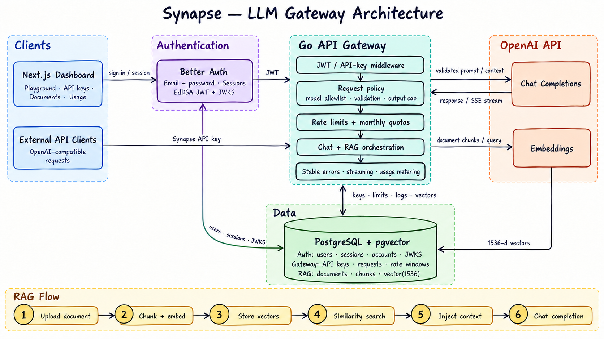

# Synapse

Synapse is an OpenAI-compatible LLM gateway with authentication, API-key management, request controls, usage metering, and pgvector-backed retrieval-augmented generation.

## Architecture

### Request paths

- **Dashboard:** The Next.js application uses Better Auth for email/password sessions and issues short-lived EdDSA JWTs. The Go API validates those JWTs through Better Auth's JWKS endpoint.
- **Gateway clients:** External applications call `POST /v1/chat/completions` with a Synapse API key using an OpenAI-compatible request shape.
- **Request pipeline:** The Go gateway authenticates the caller, validates the request and model, enforces output limits, request-rate limits, and monthly token quotas, then proxies the request to OpenAI.
- **RAG:** Documents are chunked and embedded, their 1,536-dimensional vectors are stored in PostgreSQL with pgvector, and relevant chunks are added as untrusted reference context before chat completion.
- **Observability:** Provider status, latency, rate-limit state, and token usage are recorded for the dashboard while provider failures are translated into stable Synapse errors.
- **Operations:** Zap emits readable console logs locally or JSON logs when `LOG_FORMAT=json`; `/healthz` reports process liveness and `/readyz` reports PostgreSQL readiness without calling the paid provider.

### Main components

| Component | Responsibility |
| --- | --- |
| `web/` | Next.js dashboard, Better Auth, playground, API-key, document, request, and usage interfaces |
| `cmd/` | Go service composition and HTTP server startup |
| `internal/api/` | HTTP routes, request policy, gateway orchestration, streaming, and RAG flow |
| `internal/auth/` | Better Auth JWT verification through JWKS |
| `internal/apiKey/` | API-key generation, hashing, persistence, and middleware |
| `internal/gateway/` | OpenAI chat and embedding client, retries, usage parsing, and provider errors |
| `internal/document/` | Document chunking, pgvector persistence, ownership checks, and similarity search |
| `internal/llmrequest/` | Request logs, rate limits, token quotas, and dashboard metrics |
| `internal/logging/` | Zap logger configuration for console and JSON output |
| `migrations/` | PostgreSQL, Better Auth, gateway, and pgvector schema migrations |
